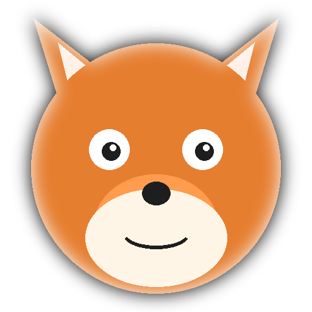
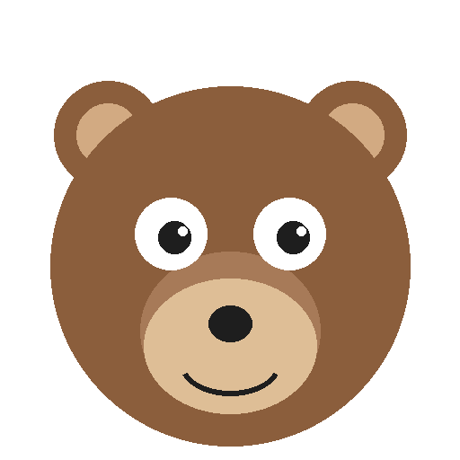
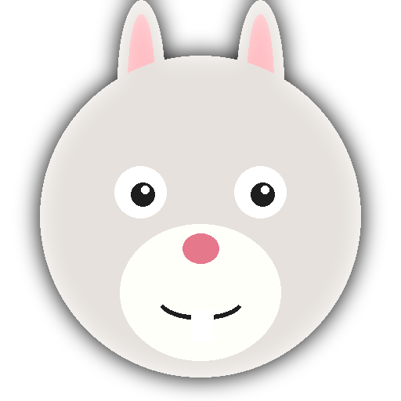
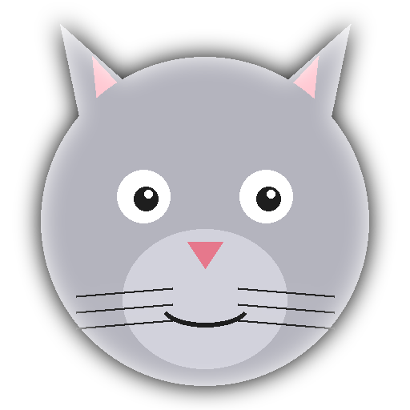

# ASD-Friendly Video Adapter

Локальный сервис, который берёт обучающее видео и делает версию, которую легче смотреть детям с РАС. Снижает сенсорную нагрузку: убирает чужие лица, резкие звуки и рваные склейки, добавляет крупные субтитры.

Для родителей, педагогов и логопедов. Загрузил MP4, подождал пару минут, скачал адаптированный ролик. Видео никуда не отправляется, всё считается на своём компьютере.

<p>
  
  
  
  
  
</p>

## Что делает с видео

- находит лица в каждом кадре и закрывает их мультяшными животными (лиса, медведь, заяц, панда, кот), маска держится за человеком между кадрами
- чистит звук от шума и выравнивает громкость до −18 LUFS, чтобы не было резких громких моментов
- ищет резкие склейки и ставит на них плавный переход 0,5 с
- распознаёт русскую или английскую речь и прожигает субтитры в кадр
- показывает оригинал и результат рядом, отдаёт готовый `adapted.mp4`

Ограничения: `.mp4` или `.mov`, до 200 МБ и до 10 минут. На обычном ноутбуке без видеокарты 30-секундный ролик обрабатывается за 2–3 минуты.

## Как запустить на Windows

Нужны Python 3.11 или 3.12 (с галочкой «Add Python to PATH») и FFmpeg в `PATH`.

1. Двойной клик по `install.bat`. Он проверит Python и FFmpeg, создаст окружение, поставит библиотеки (около 500 МБ) и нарисует маски.
2. Двойной клик по `run.bat`.
3. Открыть `http://localhost:8000`, перетащить ролик и нажать «Адаптировать».

При первой обработке скачивается модель распознавания речи (около 460 МБ), дальше она берётся из кэша.

Вручную, на любой системе:

```bash
python -m venv .venv
.venv\Scripts\activate          # macOS и Linux: source .venv/bin/activate
pip install -r requirements.txt
python scripts/generate_masks.py
uvicorn app.main:app --port 8000
```

## Как устроено

| Часть | Чем сделано |
|---|---|
| Веб и очередь | FastAPI, фоновые задачи, статусы в SQLite через SQLModel |
| Интерфейс | Jinja2 и HTMX, прогресс обновляется сам, без фреймворков |
| Лица | MediaPipe на процессоре, трекинг по пересечению рамок (IoU), наложение масок через Pillow |
| Звук | noisereduce, pyloudnorm, мягкий лимитер в FFmpeg |
| Склейки | PySceneDetect и кроссфейды FFmpeg |
| Субтитры | faster-whisper, модель `small`, SRT прожигается в кадр |

```
app/
  main.py            роуты и загрузка
  config.py          лимиты и пороги
  models.py          задача и её статусы
  pipeline/          звук, лица, сцены, субтитры, сборка
  templates/         страницы
scripts/             генерация масок
tests/               тесты
```

Все пороги (лимиты, громкость, чувствительность к склейкам, FPS) лежат в `app/config.py`. Свои маски кладутся в `app/static/masks/` как PNG 512×512 с прозрачным фоном.

## Тесты

```bash
pytest -q
```

Проверяют расчёт IoU и наложение маски, нормализацию громкости и полный прогон на синтетическом 10-секундном ролике (нужен FFmpeg).

## Что дальше

- уровни адаптации: мягкий, средний, сильный
- наборы масок по темам
- телеграм-бот поверх того же конвейера
- версия под видеокарту
